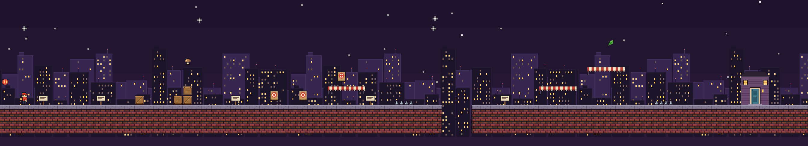

Pizza Assassin is a pixel-art stealth platformer: you play a pizza courier who sneaks up behind rival couriers, takes them out in one hit and gets the pizza to the door while it's still hot. It has 40 levels across six worlds, and none of them was made in Godot's scene editor. Every level is a plain text file in `levels/`, and a build script turns it into a scene.

This post walks through that pipeline: the map format, the parser, the scene builder, and the tests that run against every map.

## A level is a grid of characters

This is the first level, `levels/first_delivery.txt` (empty rows at the top trimmed):

```txt title="levels/first_delivery.txt"
; 1-1: learn to run, jump, swing and deliver.
@par 22
@theme street
@hint 1 HINT_MOVE
@hint 2 HINT_JUMP
@hint 3 HINT_ATTACK
@hint 4 HINT_SPIKES
@hint 5 HINT_HOT
...............................................................*....................
....................................................................................
...................*................................................................
.............................................................====...................
*..................................T................................................
...................C..............====..................====........................
..P.1.....2...C...CC....3...T..T......4..^^.........5...............^^........D.....
##############################################...###################################
##############################################...###################################
##############################################...###################################
```

And this is what the game builds from it:



One character is one 16×16 cell. `#` is ground, `=` is an awning you can jump up through, `C` is a crate, `P` is where the player spawns and `D` is the delivery door. `T` is a training dummy, `^^` is a pair of spikes, the digits are hint signs, and `*` marks a hidden topping. Later worlds add more letters: guards, sleeping rivals, springs, crumbling blocks, water, moving platforms, lamps, light switches and chandeliers. The whole legend lives in a doc comment at the top of the parser, so the format is documented in exactly one place.

Lines starting with `@` are directives. `@par` is the par time for the "still hot" star, `@theme` picks the tile set, background and music, and `@hint 3 HINT_ATTACK` says which translation key the sign marked `3` shows. Lines starting with `;` are comments, and they turned out to be the most useful part of the format. The harder levels open with a short design note:

```txt title="levels/power_cut.txt"
; 6-2: light switches. A hit puts out the lamps a switch is wired to (see
; the conduits), and someone always comes over to switch them back on.
; 1) A guard under a lamp, its switch on your side: lights out, and he
;    comes to you in the dark.
; 2) Two guards under two lamps on one switch: both come running.
```

The intent of the level sits right above the layout that implements it, and both show up in the same diff.

## Parsing: collect every error, don't stop at the first one

`LevelMap.parse()` reads the text into two things: a dictionary of tile cells (`Vector2i -> Cell`) and a list of entities (`{kind, cell, facing, ...}`). Most characters are a straight lookup:

```gdscript title="scripts/core/level_map.gd"
const TILE_CHARS := {"#": Cell.GROUND, "=": Cell.PLATFORM, "C": Cell.CRATE, "~": Cell.WATER}
const ENTITY_CHARS := {
	"P": &"player", "D": &"door", "E": &"rival", "e": &"rival", "T": &"dummy",
	"^": &"spikes", "K": &"checkpoint", "Z": &"sleeper", "S": &"spring",
	# ...
}
## Lower-case enemy letters face right; everything else faces left.
const FACING_RIGHT := "erbgn"
```

A few need context. Spikes must come in pairs, a moving platform is drawn as a path (`M----m` sideways, or `M` above a column of `|` ending in `m`), and the parser follows that path to find where the platform turns around. Hint digits must have a matching `@hint`.

The parser never throws. Anything wrong goes into `map.errors`, and parsing carries on, so a broken map reports all of its problems at once. Feeding the builder a deliberately bad four-row map gives:

```txt
broken.txt:
  unpaired spike at 5,1
  hint 3 at 5,2 has no @hint
  need exactly one door, found 0
  map is 4 rows, need at least 17
```

Some rules are about more than syntax. Light switches don't say which lamps they control: every lamp is wired to the nearest switch within 16 cells. That keeps the map readable, but it makes ties possible, so the parser rejects a lamp that is equally close to two switches, and a switch with nothing in reach. The level designer (me) finds out about an ambiguous layout before it ships, not by playing it.

## Building scenes: inherit, don't copy

`tools/levels/build_levels.gd` is a `SceneTree` script that runs headless:

```bash
godot --headless -s tools/levels/build_levels.gd
```

For every level in the catalog it parses the map, builds a node tree, and saves it to `scenes/levels/<id>.tscn`. The important detail is how that tree is built:

```gdscript title="tools/levels/build_levels.gd"
# Edit states make pack() store only differences: the level inherits
# level_base.tscn and entities stay plain instances of their scenes, so
# later changes to those scenes still reach every level.
var root: Level = BASE.instantiate(PackedScene.GEN_EDIT_STATE_MAIN_INHERITED)
```

A plain `instantiate()` would bake a full copy of the base level (camera, HUD, pause menu, backgrounds) into all 40 files. With `GEN_EDIT_STATE_MAIN_INHERITED`, the saved scene *inherits* `level_base.tscn` and stores only what differs. Enemies, doors and lamps are created with `GEN_EDIT_STATE_INSTANCE`, so each level only references `rival_courier.tscn` instead of copying it. If I change how the rival courier looks, I don't need to rebuild anything.

The rest of the builder is plain translation from map to nodes:

- **Tiles** go into one `TileMapLayer`. `tile_for()` auto-tiles ground by looking at the neighbours (top edge, left cap, right cap, fill), and the theme picks the row in the tile atlas.
- **Entities** are placed at the bottom centre of their cell, so characters stand on the floor. Lamps instead measure how far their light falls (`lamp_reach()`) and how long a cord they need to reach the ceiling.
- **Water** becomes one `Area2D` with a collision strip for each horizontal run of water surface.
- **Dark levels** (any map with lamps or night watchmen) get a darkness overlay.

The generated scenes are committed, but nobody edits them by hand. The builder's own header says so.

## Keeping the diffs honest

The first version had one annoying problem. Godot 4 gives every node in a saved scene a random `unique_id`, and a new one on every save. Rebuilding the levels after a one-character change to one map rewrote every level's scene file.

The fix is a post-processing pass. Before saving, the builder reads the old file. After saving, it puts the old id back on every node that already existed, matched by parent path and name:

```gdscript title="tools/levels/build_levels.gd"
## text with each node's unique_id taken from old_text, for the nodes that
## were already there (same parent and name).
func _keep_node_ids(text: String, old_text: String) -> String:
	var old_ids := {}
	for line in old_text.split("\n"):
		var key := _node_key(line)
		if key != "":
			old_ids[key] = _node_id.search(line).get_string()
	var lines := text.split("\n")
	for i in lines.size():
		var key := _node_key(lines[i])
		if old_ids.has(key):
			lines[i] = _node_id.sub(lines[i], old_ids[key])
	return "\n".join(lines)
```

That works because node names are deterministic. Entities are named by kind and order (`Rival1`, `Lamp3`), so the same map always produces the same names. Now a rebuild prints `unchanged` for every level I didn't touch, and the diff for a level edit shows only the nodes that actually moved.

## Tests that know how far the player jumps

Text maps make levels easy to test, because a test can parse them directly. `tests/unit/test_levels.gd` (run with [GUT](https://github.com/bitwes/Gut)) checks every level in the catalog.

**The door is reachable, and no ledge is stranded.** The test finds every surface the player can stand on (solid, with two free cells of headroom), then runs a breadth-first search from the spawn using jump limits derived from the movement settings:

```gdscript title="tests/unit/test_levels.gd"
## Jump reach in tiles, from MovementStats defaults (48 px jump, 110 px/s):
## about 4.3 tiles across when landing 1 tile higher, 3.8 when 2 higher.
const REACH_UP_1 := 4
const REACH_UP_2 := 3
const MAX_CLIMB := 2
## A spring (96 px launch) reaches 6 tiles up, drifting up to 4 across.
const SPRING_CLIMB := 6
const SPRING_REACH := 4
```

The door has to be in the reachable set, and so does every other surface. An unreachable ledge is either a mistake or a dead end, and both are worth catching.

**Every topping can be collected.** Each level hides exactly three, none inside a wall, each at most three cells above a reachable surface (higher over a spring), and none past the door, since touching the door ends the level.

**The par time is fair.** Par has to be between 1.4× and 5× the time it takes to sprint flat out across the whole map. Below that the star is impossible, and above it there's no hurry.

**The engine's limits hold.** The darkness shader takes at most 16 light sources at once, so the test slides a 40-tile window (about one wide phone screen) across each dark level and counts lamps, chandeliers and night watchmen inside it.

**The scene matches the map.** This one parses the map, loads the generated scene and compares tile count, spawn point, door position, camera bounds and par time. It fails whenever I edit a `.txt` and forget to run the builder, and it tells me so in the failure message.

## What this setup gives me

- **Levels review like code.** A layout change is a few changed characters in a diff, next to the comment that explains it.
- **Mistakes show up in a test run, not in a playtest.** "This ledge can't be reached" and "these two switches fight over one lamp" are errors with coordinates.
- **Shared scenes stay shared.** The builder inherits the base level and instances everything else, so changing the rival courier or the HUD reaches all 40 levels without rebuilding them.

The main trade-off is that layout is the only thing the map can express. A level that needs something staged precisely, rather than placed on a grid, would need another directive or a hand-made scene. All 40 levels so far have fit in a grid of characters.
